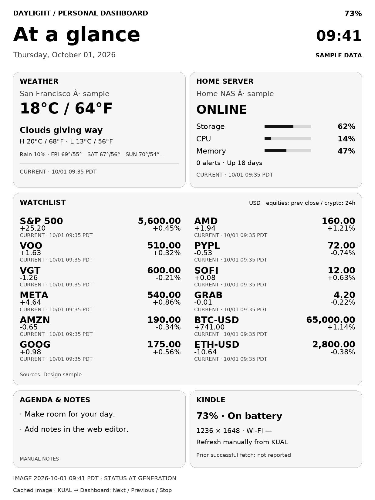

# Kindle Dashboard

A KUAL-launched, manual dashboard for a jailbroken Kindle Paperwhite, backed by
a Docker service on your NAS. The Kindle sends its battery state and screen
dimensions; Python/Pillow returns a complete grayscale PNG.

**Start with the [installation guide](docs/setup.md).** It generates matching NAS
and Kindle configuration, including a private USB-installable ZIP and shared token.
The NAS also offers a [widget layout editor](docs/dashboard-editor.md) at `/` and authenticated contact/source
diagnostics at `/status`. See the [data contract](docs/product-contract-v1.md)
for the longer-term portfolio, research and touchscreen roadmap.

**Implemented:** configurable single-page widget overview with all 12 tickers,
browser preview/save/reorder/resize/import/export, expanded watchlist and optional
[ChatGPT usage snapshot](docs/chatgpt-usage.md), five-page image service, optional NAS-side weather/market/crypto
collectors, TrueNAS snapshot exporter, persisted source timestamps, optional
contact telemetry, battery sampling, offline KUAL carousel, one-shot/batch
refresh, start/stop, and cached restoration after verified native lockscreen exit.
**Hardware evidence:** one Paperwhite successfully displayed through `eips` at
1072 × 1448 and completed Stop Dashboard. Other devices still need display/KUAL
checks. **Pending:** the device-specific wake profile. `WAKE_RESTORE=0` until that
profile is confirmed. Live sources require your location/provider configuration.
**Deferred:** touchscreen input, brokerage/analysis integrations, Wi-Fi control,
scheduled wake and automatic Kindle network refresh.

This is separate from Amazon's lockscreen. It never changes Special Offers.
The normal power button may show Amazon's advertisements. The framework remains
running and may repaint over the dashboard. Keeping the image visible through
suspend cannot be promised before device-specific testing.



The example is visibly labeled **sample data**. Browse all five
[design previews](docs/previews/). The server never enables sample data by default.
See [pages and source snapshots](docs/pages-and-data.md) and
[native sleep / wake setup](docs/native-wake.md) for the new functionality.

## Architecture

```text
KUAL -> shell reads battery, charging, dimensions, model
     -> GET /dashboard.png?battery=73&charging=0&width=1236&height=1648&device=paperwhite
NAS  -> FastAPI validates inputs -> Pillow renders grayscale PNG in memory
Kindle -> temporary file -> HTTP/PNG checks -> atomic cache -> full-screen draw
       -> action exits; optional listener blocks on native power events
       -> confirmed lockscreen exit -> redraw local cache, without networking
```

See [architecture and repository tree](docs/architecture.md). No database, native
GUI, custom binary build, system patch, boot integration, or plugin framework is
required. Missing weather/market/NAS source values are labeled unavailable.
Without a NAS snapshot, service status means only that this image service
responded; it does not claim to monitor the host or other containers.

## 1. Install and run diagnostics first

Prerequisites: an already jailbroken Kindle with working KUAL, ordinary shell
utilities (`awk`, `od`, `mktemp`, `head`, `tr`, etc.), and eventual LAN access to
the NAS. MRPI and KOReader may stay installed; this project does not modify them.

1. Copy `kindle-client/extensions/dashboard/` to the Kindle USB drive under
   `extensions/dashboard/` (internally `/mnt/us/extensions/dashboard/`). Include
   `config.xml`, `menu.json`, scripts, and `lib/`. Runtime directories are created
   automatically. No MRPI package is needed.
2. Safely eject USB, reopen KUAL, select **Dashboard -> Show Diagnostics (save
   report)**. It saves a report and leaves KUAL open.
3. Retrieve `extensions/dashboard/logs/diagnostics.txt` over USB.

Use [the diagnostics guide](docs/diagnostics.md) for the information to send back.
Do not send tokens or device serial numbers. All scripts use LF line endings and
are launched through `sh`, so USB filesystem executable-bit behavior is harmless.

To build a ZIP whose `extensions/` folder can be copied to the USB root:

```sh
python scripts/package-client.py
```

The result is `dist/kindle-dashboard-client.zip`. Store private values in
`config.local.sh`, which the standard package excludes. The public `config.sh`
must retain empty token defaults. Use `scripts/setup.py` for a private configured
ZIP; never publish that ZIP or `server/.env`.

## 2. Deploy the NAS service

On the Docker host, from this repository:

```sh
cd server
cp .env.example .env
# Edit .env: API_TOKEN, DASHBOARD_TIMEZONE and optionally BIND_ADDRESS.
docker compose up -d --build
curl http://127.0.0.1:8080/health
```

Expected health: `{"status":"ok"}`. Use the NAS LAN IP in the Kindle URL, not
`localhost`. Allow the Kindle's network to reach TCP 8080. Keep the service on
your trusted LAN; optional bearer authentication over HTTP is not encrypted.
HTTPS works when the Kindle trusts the certificate; the client does not disable
certificate verification. Do not expose this service directly to the internet.

See [server setup and API contract](server/README.md) for a test image request,
dimension clamping, time zones, fonts, and local development.
See [the complete setup guide](docs/setup.md) for live sources and a TrueNAS
Custom App YAML. The optional `live` Compose profile runs the collector only on
the NAS; it does not change the Kindle's manual refresh policy.

## 3. Configure and refresh the Kindle

Edit `extensions/dashboard/config.sh` with an LF-aware editor. Defaults use
`${NAME:=value}` so environment variables can override them in mock tests.
For example, change these lines' default values:

```sh
: "${DASHBOARD_URL:=http://192.168.1.20:8080/dashboard.png}"
: "${API_TOKEN:=your-shared-token}"
: "${CONNECT_TIMEOUT_SECONDS:=10}"
: "${DOWNLOAD_TIMEOUT_SECONDS:=30}"
```

An empty token disables authentication only when the server token is also empty.
Use a plain endpoint URL with no query, embedded password, or fragment. A token
belongs in the Authorization header, never in the URL. Config is trusted shell
code: use a simple random ASCII token and never paste untrusted shell commands.

| Setting | Default / behavior |
| --- | --- |
| `DISPLAY_BACKEND` | `auto`: FBInk first, then eips |
| `FBINK_BIN`, `EIPS_BIN` | Command names; set an absolute installed path if needed |
| `SCREEN_WIDTH`, `SCREEN_HEIGHT` | Detect; override with verified physical pixels |
| `DEVICE_MODEL` | Detect from device tree / CPU hardware label; optional override |
| `BATTERY_CAPACITY_FILE`, `BATTERY_STATUS_FILE` | Optional diagnostic-confirmed paths |
| `HTTP_CLIENT` | `auto`: curl preferred; supported wget as fallback |
| `KUAL_SETTLE_SECONDS` | 2, adjustable 0–10 for KUAL closing repaint |
| `MAX_IMAGE_BYTES` | 4 MiB; allowed maximum 8 MiB |
| `MAX_LOG_BYTES` | 64 KiB plus one rotated log |
| `DEFAULT_PAGE` | `overview`; also weather, markets-1, markets-2, nas |
| `DEVICE_ID`, `SEND_TELEMETRY` | User-chosen label and optional contact telemetry, enabled by default |
| `WAKE_RESTORE` | 0 until exact model/firmware and lockscreen-exit guard verified |
| `ENABLE_EXPERIMENTAL_POWER`, `AUTO_REFRESH` | 0; enabling is rejected in this version |

Battery detection tries configured paths, read-only powerd LIPC properties,
battery entries under `/sys/class/power_supply`, legacy sysfs paths, and
`gasgauge-info -c`. Charging is obtained independently from LIPC or battery status.
Unknown readings are omitted from the request and rendered as unknown. `Full`
means not actively charging; it does not imply the cable is unplugged. Firmware
is recorded in diagnostics; the API does not need it.
Wi-Fi signal and the previous download result can accompany image requests.
The server records last contact separately from download success and source time.
See [telemetry and battery measurement](docs/battery-and-telemetry.md).

Screen geometry is read via FBInk, recognizable `eips -i` fields, or `fbset`.
It does not treat the framebuffer's virtual double-buffer size as physical size.
If geometry is unknown, set both dimensions after reviewing diagnostics. The
client requires 320–2560 pixels per side and rejects mismatched returned images.

Enable/connect Wi-Fi in Kindle Settings, then select **Refresh Dashboard** in
KUAL. The client uses that connection and exits after one fetch/draw. Wi-Fi and
frontlight settings remain yours; turn them off/down normally when appropriate.
A successful test should show battery telemetry in the request log and a full
image on the screen. Follow [the hardware acceptance checklist](docs/hardware-testing.md).

FBInk must be a compatible, image-enabled existing build. It need not be
installed for eips fallback. Older/stripped eips builds may reject PNGs; the
display commands are isolated in `lib/display.sh`. No binaries are bundled.

## Cache and failures

Each action holds an atomic directory lock. It downloads to a unique `mktemp`
file alongside the cache with finite time and size limits, requires HTTP 200 and
`image/png`, checks PNG signature, chunk framing, grayscale IHDR, IDAT/IEND and
exact dimensions, then atomically replaces `cache/dashboard.png`. If present,
`pngcheck` additionally verifies CRCs and compressed data. Without it, structural
validation is not a complete decoder; the display backend does the decoding.

A temporary previous-image backup allows rollback if drawing fails or a
catchable signal interrupts drawing. Failed transfers never promote a partial
file. A previous valid cache is redrawn when possible, with its original generated
timestamp. Actions return nonzero on fetch failure even if the cached page draws
successfully. There is no rapid retry loop.

The first install has no cached image. If the first request fails, the normal UI
remains available. Temporary files are cleaned on ordinary exit/signals. A hard
reset or power loss may leave a stale lock or temporary backup; see recovery.

curl is preferred. The wget path needs `timeout`, `--max-redirect`, `--tries`,
`-T`, `-S`, `-O`, and `--header` when authentication is enabled. GNU wget supports
these; many BusyBox builds do not. Unsupported builds fail without an unsafe
fallback. Redirects are deliberately rejected. A filesystem size limit bounds
transfer files; the exact byte limit is also checked after download.

## Start, exit, and recovery

**Start Dashboard** creates `state/active`, refreshes once, and exits. A cached
page can keep the session active during a NAS outage. A start that cannot display
any page removes the active marker. With a verified `WAKE_RESTORE=1` profile it
also starts a blocking native event listener. That listener makes no power writes,
takes no suspend inhibitor, and restores only the cache after a confirmed unlock.
The marker alone never starts a task.

**Refresh All Pages** fetches at most five images, stops at the first failure,
and preserves each page's last valid cache. **Next/Previous Dashboard (cached)**
wrap through those local pages without network access. These are KUAL actions;
touchscreen taps directly on the dashboard are not implemented.

**Stop Dashboard** disarms wake workers and terminates the owned listener, clears
the marker and leftover temporary files, retains the cache, and asks KUAL to
reload its normal menu. The framework was never stopped
or hidden. Navigate normally to Home or a book. Stop from SSH with:

```sh
sh /mnt/us/extensions/dashboard/stop.sh
```

An SSH stop does not synthesize Home presses; reopen KUAL or navigate normally to
repaint. The normal power-button sleep/wake path remains available and may show
Amazon's ad lockscreen.

For the kill switch, create an empty file named `dashboard-disable` at the Kindle
USB root (`/mnt/us/dashboard-disable`), with no `.txt` suffix. Start and refresh
then refuse to fetch/draw; stop and diagnostics still work. An in-flight request
rechecks it before committing the image. It does not forcibly interrupt an
already running display command. See [exact recovery steps](docs/recovery.md).

## Testing and mock mode

Python 3.13 is used by Docker. On an ordinary Linux development machine:

```sh
python -m venv .venv
. .venv/bin/activate
pip install -r server/requirements-dev.txt
python -m pytest -q
sh scripts/test-shell.sh
python scripts/generate-example.py
```

Tests cover endpoint validation/authentication/rendering, real HTTP shell fetches,
malformed/truncated/wrong-size PNGs, failures preserving the cache, display rollback,
kill switch, deadlines, locks, log rotation, telemetry, and start/stop. Windows
can run the same pytest suite with Git Bash installed. Docker and hardware
acceptance are separate checks; host mock tests do not prove Kindle compatibility.

With the service running locally, test the complete download path without a
framebuffer:

```sh
MOCK_MODE=1 MOCK_BATTERY=73 MOCK_CHARGING=0 MOCK_WIDTH=1236 MOCK_HEIGHT=1648 \
  DASHBOARD_DATA_DIR=/tmp/kindle-dashboard-mock \
  DISABLE_FILE=/tmp/kindle-dashboard-disable \
  DASHBOARD_URL=http://127.0.0.1:8080/dashboard.png API_TOKEN=your-shared-token \
  sh kindle-client/extensions/dashboard/refresh-once.sh
```

Inspect `/tmp/kindle-dashboard-mock/cache/dashboard.png` and the logs. Drawing
commands are logged instead of executed. `MOCK_BATTERY=unknown` and
`MOCK_CHARGING=unknown` exercise unavailable readings. Never leave `MOCK_MODE=1`
in the installed Kindle config.

## Troubleshooting and limitations

| Symptom | Next step |
| --- | --- |
| Dashboard missing in KUAL | Check `extensions/dashboard/config.xml` and `menu.json`; eject USB and reopen KUAL |
| No image / refresh exits | Read `logs/dashboard.log`; test NAS `/health`, Wi-Fi and token |
| Unknown dimensions | Send diagnostics; set verified `SCREEN_WIDTH` and `SCREEN_HEIGHT` |
| PNG rejected | Check reverse proxy/auth errors, dimensions and MIME type; redirects are unsupported |
| Download fails with wget | Verify supported options and `timeout`, or use an existing curl installation |
| FBInk selected but fails | Check image-enabled compatible build/path; explicitly try eips after diagnostics |
| Image overwritten or ads appear on sleep | Expected possible framework behavior; no ad bypass or suspend guarantee |
| Ghosting | Full refresh is requested; verify actual backend behavior on this firmware |
| Stop blocked by lock | Wait for the bounded request to finish; use the stale-lock recovery procedure |
| Clock/weather/markets do not update | Images are snapshots; publish source data and refresh manually |
| Page not cached | Use Refresh All Pages at the current screen resolution |
| Wake does not restore dashboard | Read native-wake.md; feature needs a verified profile and native lockscreen exit |
| Battery use higher than expected | Check radio/frontlight and normal Kindle behavior; no battery-life claim has been measured |

No model/firmware combination is certified yet. A model label from `/proc/cpuinfo`
can name the SoC rather than the marketed Kindle model. Core utilities and display
option support vary. Retained pixels do not establish that the CPU is suspended.

## Release and container builds

GitHub Actions runs Linux tests, ShellCheck and a Docker smoke test. Successful
main-branch runs then publish `ghcr.io/<owner>/kindle-dashboard:latest` and an
immutable `sha-<commit>` tag for Linux amd64/arm64. The workflow also attaches a
public Kindle ZIP as a build artifact. A configured/private ZIP is never built
by CI. Check the workflow result before using a published image; the existence
of a Dockerfile alone is not proof of a successful build.

## Future power work (Milestone 5)

Only after diagnostics and measured tests: determine supported suspend/wake and
whether retaining the dashboard is compatible with the unchanged lockscreen.
If feasible, consider 60-minute updates, 4-hour night updates, and reduced activity
below 20% battery. Those values exist in config as reserved policy only. There is
currently no schedule, automatic boot launch, powerd write, or `/sys/power/state`
write. The implemented listener observes native sleep/wake without initiating
either. See [upstream references](docs/references.md) for the API assumptions.
