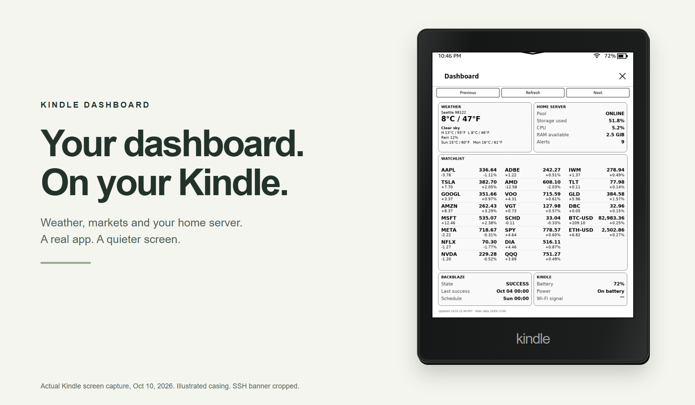
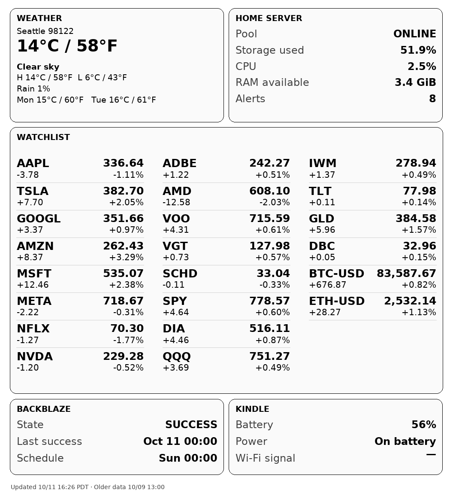
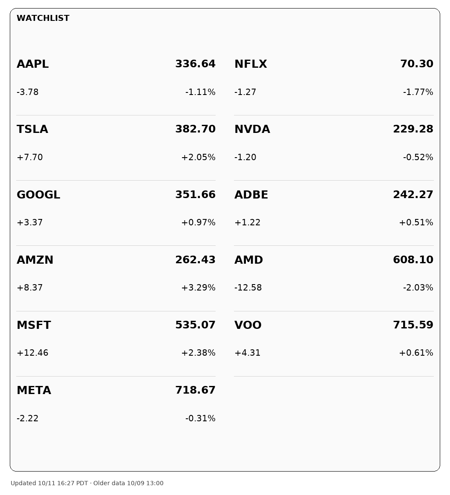
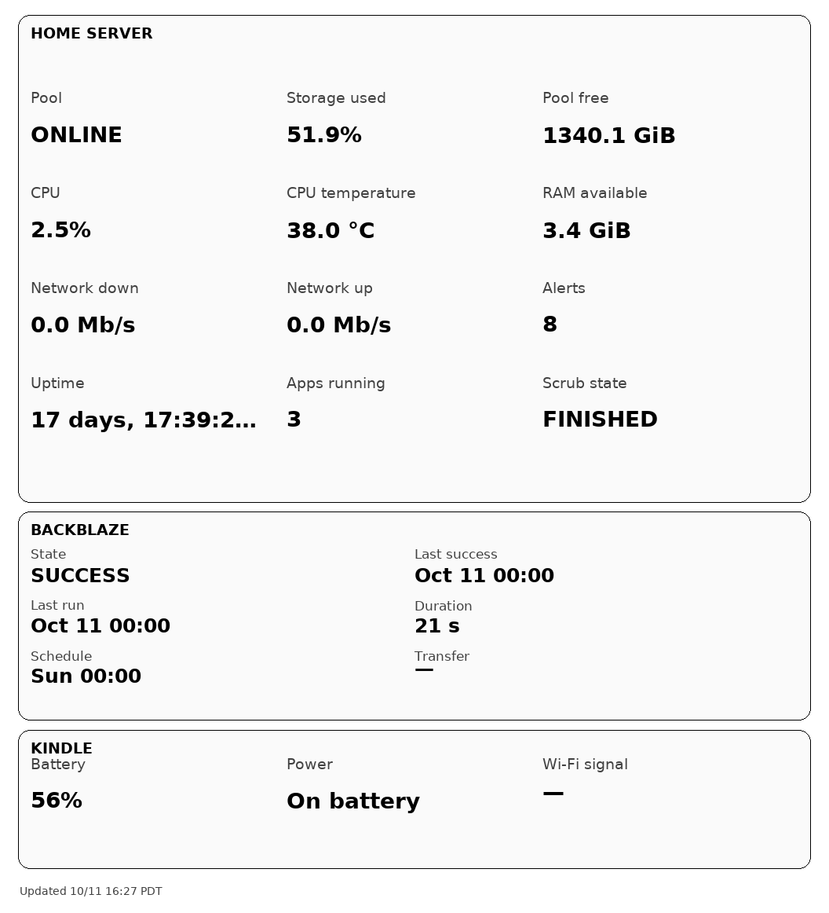
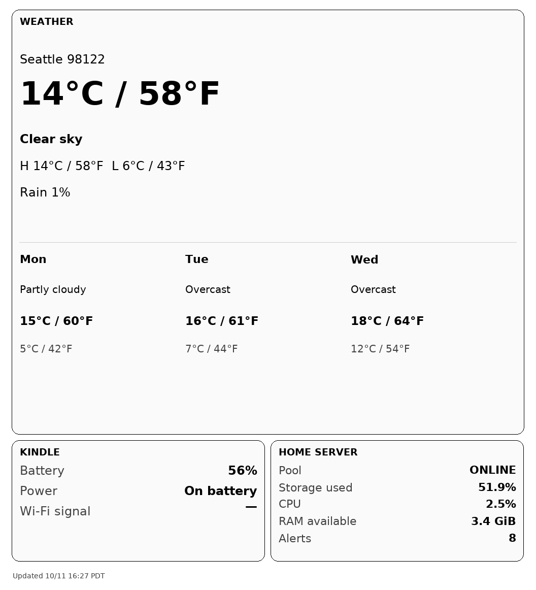
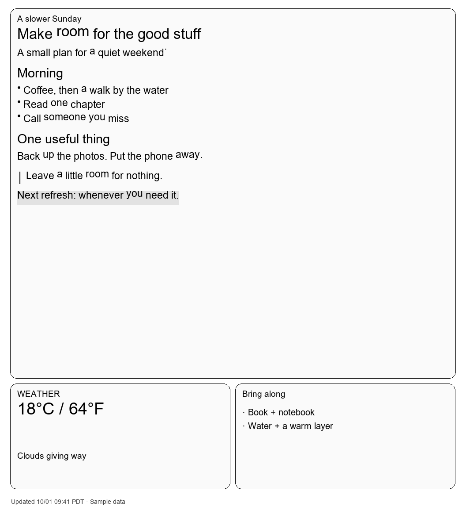
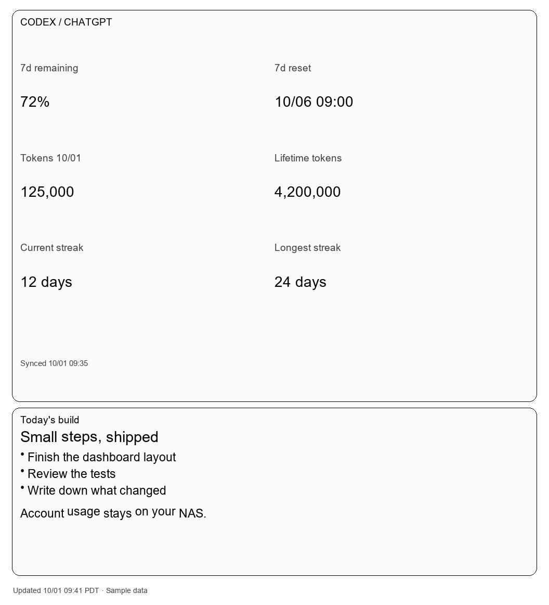
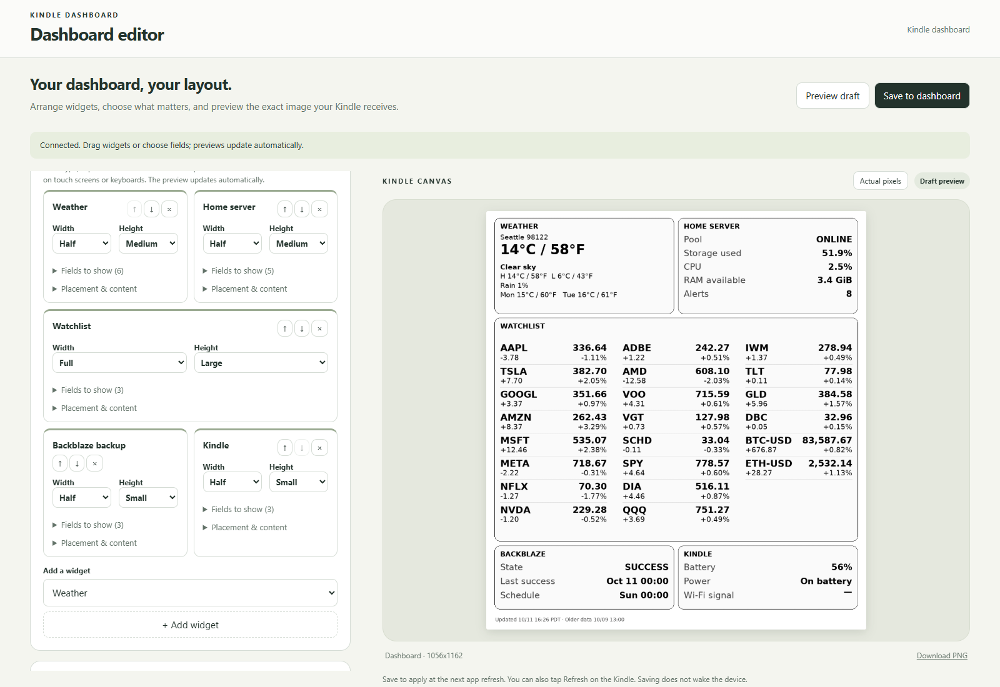
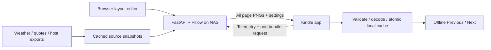

# Kindle Dashboard

**A quieter place for your day.** A self-hosted dashboard for a jailbroken Kindle: weather, markets, home-server health, Markdown, and more. Design pages in your browser; the NAS renders them for e-ink.



[Download client](https://github.com/zihengjackchen/kindle-dashboard/releases/latest) · [Get started](#get-started) · [Screenshot gallery](docs/showcase/README.md) · [Layout editor](docs/dashboard-editor.md) · [Kindle installation](docs/kindle-app.md) · [Power & recovery](#power-and-recovery)

Open **Dashboard** from the Kindle library or KUAL. Tap **Previous / Next** to change pages, **Refresh** to fetch every page in one request, and the native **X** to return Home. Cached pages keep working when the network doesn't.

> Hardware-tested on a 1072 × 1448 Paperwhite running firmware **5.16.2.1.1**. Other models need diagnostics first. Amazon Special Offers and the normal lockscreen are untouched. Continuous visibility uses an opt-in foreground sleep hold; deep sleep with the dashboard visible is **not implemented**.

[Launch showcase: storyboard, poster and editable video project](brag-output/README.md)

## Running on a real Kindle

The hero uses a real framebuffer capture from the tested Paperwhite, including its native title bar, X and navigation. The casing is illustrated; the SSH banner is cropped. [Real device and NAS captures, with dates](docs/showcase/live/README.md).

## Make it yours

<table>
<tr><td width="33%"><a href="docs/showcase/live/nas-overview.png"></a><b>Your everyday overview</b><br>Weather, watchlist, backup and battery.</td><td width="33%"><a href="docs/showcase/live/markets.png"></a><b>A dedicated watchlist</b><br>Stocks, ETFs and crypto in multiple columns.</td><td width="33%"><a href="docs/showcase/live/home-server.png"></a><b>Your home server</b><br>Storage, CPU, memory and backup status.</td></tr>
<tr><td><a href="docs/showcase/live/weather.png"></a><b>Weather &amp; plans</b><br>Celsius and Fahrenheit together.</td><td><a href="docs/showcase/markdown.png"></a><b>A page of your own</b><br>Markdown headings, lists, quotes and code.</td><td><a href="docs/showcase/codex.png"></a><b>Codex account usage</b><br>Optional allowance and activity from your NAS login.</td></tr>
</table>

The overview, weather, markets and NAS images use **real data from the running service**. Markdown and Codex cards remain labeled **sample-data examples**. The hero and editor use **real captures** from the running installation. The device casing is an illustration; [capture dates and privacy edits](docs/showcase/live/README.md) are documented. [Browse all screenshots and importable layouts →](docs/showcase/README.md)

## A browser editor, an e-ink display



- **Arrange the page:** drag widgets, choose half/full width and three sizes, or assign rows and columns. Up to 12 widget instances per page, including repeated types.
- **Choose the details:** custom titles, selectable fields, individual watchlists and backup jobs. Markdown shrinks or truncates to fit its card.
- **Preview before saving:** render at the Kindle app's actual canvas size, zoom to actual pixels, and download the PNG. Draft changes stay separate until saved.
- **Make several pages:** configure five page slots, rename and reorder them, enable optional rotation, and export/import layouts as JSON.
- **Keep it quiet:** large grayscale text, no permanent status strip, progress inside Refresh, and one image timestamp. Stale sources stay identifiable.

| Widget | What it can show | Data comes from |
| --- | --- | --- |
| Weather | Conditions, high/low, rain probability, forecast, °C + °F | NAS collector / Open-Meteo |
| Markets | Prices, absolute and percentage changes; two or three columns | Finnhub or Twelve Data; Coinbase for crypto |
| Home server | Pool health, capacity, CPU, RAM, temperature, network, apps, scrub and alerts | Read-only TrueNAS host export; availability varies |
| Backup | Job state, last success/run, duration, schedule and progress | TrueNAS Cloud Sync jobs, including Backblaze B2 |
| Kindle | Battery, charging, Wi-Fi signal, storage, uptime, light, firmware and fetch status | Device telemetry; unsupported values omitted |
| Notes / Markdown | Reminders, plans, lists, headings, quotes and code | Your saved layout |
| Codex | Remaining allowance, reset time, token activity and streaks | Optional NAS-side Codex account collector |

The Codex collector reads filtered account metrics through an existing NAS Codex login; it does not run a model or require your PC. Brokerage portfolios, trading signals and a calendar-provider integration are not included.

## Get started

You need a jailbroken Kindle with KUAL and a compatible Mesquite/scriptlet launcher, plus a Linux Docker host or suitable TrueNAS SCALE installation. KOReader is not required. The native app also needs `curl`, `sqlite3`, and BusyBox `httpd` with CGI support. A verified prebuilt helper is available for the tested ARMv7 device; [check compatibility first](docs/kindle-app.md#http-helper-for-legacy-arm-kindles).

### 1. Configure and start the NAS

Clone this repository, then from its root:

```sh
git clone https://github.com/zihengjackchen/kindle-dashboard.git
cd kindle-dashboard
python3 -m venv .venv
. .venv/bin/activate
pip install -r server/requirements.txt
python scripts/setup.py --nas-url http://YOUR_NAS_IP:8080 \
  --timezone America/Los_Angeles --device-id bedside \
  --latitude 47.61 --longitude -122.33 --location Seattle --unit F
cd server
docker compose up -d --build
```

Setup creates a matching private `server/.env` and `dist/private/kindle-dashboard-configured.zip`. Use a reachable NAS address. It generates a bearer token and refuses to overwrite an existing configuration.

Open `http://YOUR_NAS_IP:8080/` and connect with the token from `.env`. Enable live collectors and configure provider keys using the [deployment guide](docs/setup.md). Missing integrations display as unavailable; production never falls back to invented values. On TrueNAS, use the documented dataset permissions and host-export procedure.

Prebuilt NAS images are also published for **linux/amd64** and **linux/arm64**:

```sh
docker pull ghcr.io/zihengjackchen/kindle-dashboard:latest
```

The image accepts the same environment variables and `/data` and `/state` mounts as the supplied Compose file. [Container package](https://github.com/zihengjackchen/kindle-dashboard/pkgs/container/kindle-dashboard).

### 2. Install on the Kindle

1. Run [diagnostics](docs/diagnostics.md) before enabling model-specific features.
2. Prepare the compatible HTTP helper if needed: `python scripts/prepare-httpd.py`. Follow the [native app installation guide](docs/kindle-app.md) to copy it or include it in your private ZIP.
3. Extract the configured ZIP into the Kindle USB root, merging `documents/` and `extensions/`.
4. Safely eject. Open **Dashboard** in the library, or **KUAL → Dashboard → Start Dashboard**.
5. Use the web editor to save a layout, then tap **Refresh** on the Kindle.

Keep configured ZIPs private: they contain your NAS bearer token. Public release packages omit credentials and the optional third-party helper binary. Kindle overrides belong in `extensions/dashboard/config.local.sh`.

### 3. Choose a refresh and power policy

The app defaults to an hourly refresh, four hours at night (22:00–07:00), and slower updates below 20% battery when not charging. Rotation starts disabled. These timers operate **while the app is awake**; they cannot wake a suspended Kindle.

For a primarily plugged-in display, enable the foreground hold in `config.local.sh` after checking diagnostics:

```sh
KEEP_AWAKE_PLUGGED=1
KEEP_AWAKE_ON_BATTERY=0
```

Set the second option to `1` only if you also want continuous visibility on battery. Public defaults leave both disabled. [Read the power behavior and recovery procedure](docs/kindle-app.md).

## How it works



The Kindle sends battery/charging, canvas dimensions, model and available device telemetry. The NAS renders every enabled page in grayscale. A session-only loopback bridge keeps the NAS token outside browser JavaScript. All images are validated and decoded before the new bundle replaces the cache; failed fetches retain the last successful pages.

The renderer has no Docker socket or host administration credentials. Source collection runs separately, and rendering does not wait for external providers. No database, WebSockets, custom kernel, boot integration or KOReader dependency is needed.

## Power and recovery

- The app lowers the frontlight on entry and restores its previous setting on exit. Some older Paperwhites still glow at level zero; true light-off needs a verified hardware path.
- Native events supervise the session, with a 30-minute fallback audit. There is no recurring browser heartbeat.
- Foreground keep-awake prevents idle sleep while the app is visible and releases on exit. The real power button keeps its normal behavior.
- **Battery endurance has not been measured.** The display is e-ink, but keeping WebKit and the CPU awake costs energy. There is no claim of multi-day or multi-week continuous operation.
- Deep sleep with the dashboard visible and periodic hardware wake are **not supported**. A disabled, one-cycle [native alarm experiment](docs/native-sleep.md) is diagnostic only.
- Exit with native **X**, **KUAL → Stop Dashboard**, or `sh /mnt/us/extensions/dashboard/stop.sh`. If needed, create `dashboard-disable` at the USB root, eject and restart normally. The app does not automatically launch at boot.

Normal Amazon sleep may show Special Offers. This project does not remove, patch, replace or bypass that lockscreen.

## Documentation

| Guide | Contents |
| --- | --- |
| [Setup](docs/setup.md) | Docker, source configuration, TrueNAS and permissions |
| [Kindle app](docs/kindle-app.md) | Native launcher, HTTP helper, controls and recovery |
| [Editor](docs/dashboard-editor.md) | Widget fields, placement, Markdown and layout files |
| [Diagnostics](docs/diagnostics.md) | Model, command and power inspection |
| [Codex usage](docs/codex-usage.md) | Optional NAS collector and data boundaries |
| [Server](server/README.md) | API, development and deployment details |
| [Feature status](docs/feature-status.md) | Implemented features and remaining hardware checks |
| [Gallery](docs/showcase/README.md) | Full-size screenshots and example layouts |

## Development

```sh
pip install -r server/requirements-dev.txt
python -m pytest -q
pip install playwright
playwright install chromium
python scripts/test-editor.py
python scripts/test-kindle-app.py
python scripts/package-client.py
python scripts/build-showcase.py
```

Shell tests need Linux or Git Bash. `DASHBOARD_TEST_BROWSER` can select an installed Chromium/Edge. Docker includes DejaVu fonts; the screenshot generator uses an installed font or Pillow's fallback. [Showcase reproduction notes](docs/showcase/README.md#reproduce-the-gallery) explain the public fixture.

```text
kindle-client/   Native app, KUAL extension and shell libraries
server/          FastAPI service, Pillow renderer, collectors and tests
scripts/         Setup, diagnostics tooling, packaging and screenshot generator
docs/            Installation, architecture, power notes and sample gallery
brag-output/     Launch-video storyboard and editable Hyperframes composition
```

## Credits and license

MIT for this project's code. Thanks to [KWordle](https://github.com/crizmo/KWordle) for the native-launcher reference, and [alexishida/kindle-dashboard](https://github.com/alexishida/kindle-dashboard), [1RandomDev/kindle-smarthome-dashboard](https://github.com/1RandomDev/kindle-smarthome-dashboard), and [jstriblet/kindle-wall-display](https://github.com/jstriblet/kindle-wall-display) for approaches worth studying. See [reference notes](docs/references.md) for boundaries and attribution.

The launch showcase uses the [brag skill](https://github.com/latent-spaces/brag) and [Hyperframes](https://github.com/heygen-com/hyperframes). Kindle and Amazon are trademarks of their respective owners; this is an independent project.
