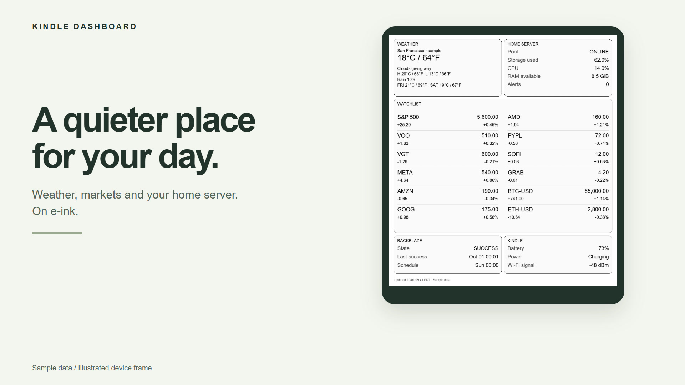

# Launch showcase

A 20-second product film created using the [brag skill](https://github.com/latent-spaces/brag)
and [Hyperframes](https://github.com/heygen-com/hyperframes).

The film shows actual renderer output, the real web editor, and a simulated tap
on the real client interface. All metrics are synthetic; device frames are
illustrations. The soundtrack is an original, locally synthesized score.

[](composition/index.html)

## Preview and rebuild

Requires Node.js 22+, a Chromium browser, FFmpeg and FFprobe. These tools are for
the showcase only; the Kindle app and NAS server do not depend on them.

```sh
# From the repository root, after installing the Python/browser dev dependencies:
python scripts/build-showcase.py
python scripts/build-brag-assets.py
cd brag-output/composition
npm run check
npm run dev
```

The composition pins Hyperframes 0.8.149 and GSAP 3.14.2. Review the local preview,
then export with:

```sh
npm run render -- --quality delivery --output ../brag.mp4
ffmpeg -ss 2 -i ../brag.mp4 -frames:v 1 -q:v 2 ../brag.jpg
```

Use the settled hook at two seconds as the poster, and bake it into frame zero
so players can show a useful thumbnail. The included `brag.jpg` previews that beat. The editable source and
storyboard remain in Git. See [asset provenance](composition/assets/NOTICE.md).

- [Storyboard](brag-plan.md)
- [Composition brief](composition-brief.md)
- [Share copy](share-copy.txt)

The Hyperframes audit passed runtime, layout and all 19 sampled text contrast
checks. Its six advisory lint warnings concern keeping four short scenes in one
file and reusing the weather PNG; there are no runtime or visual audit errors.
