# Screenshot gallery

These images come from the real Pillow renderer, browser editor, and Kindle app
HTML. Every metric is **synthetic sample data**. They are not photographs of a
physical Kindle; the hero uses an illustrated frame, and the client screenshot
omits Amazon's native window chrome.

Click an image to view it at full resolution. Each dashboard is rendered at the
tested app canvas size, **1056 × 1162**, rather than the full panel dimensions.

| Everyday overview | Markets |
| --- | --- |
| [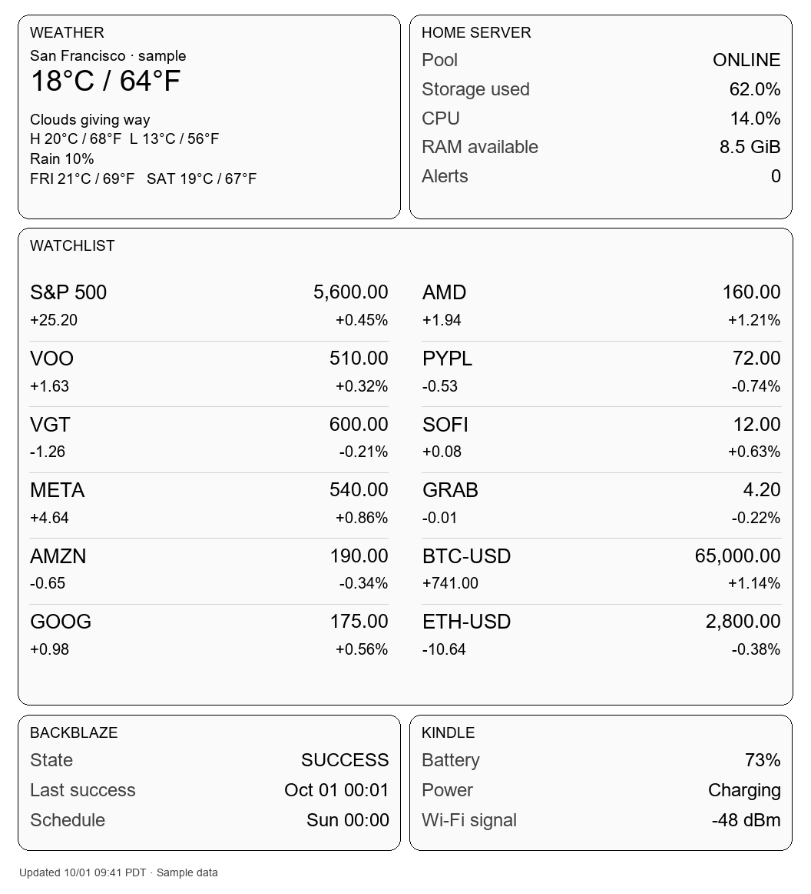](overview.png) | [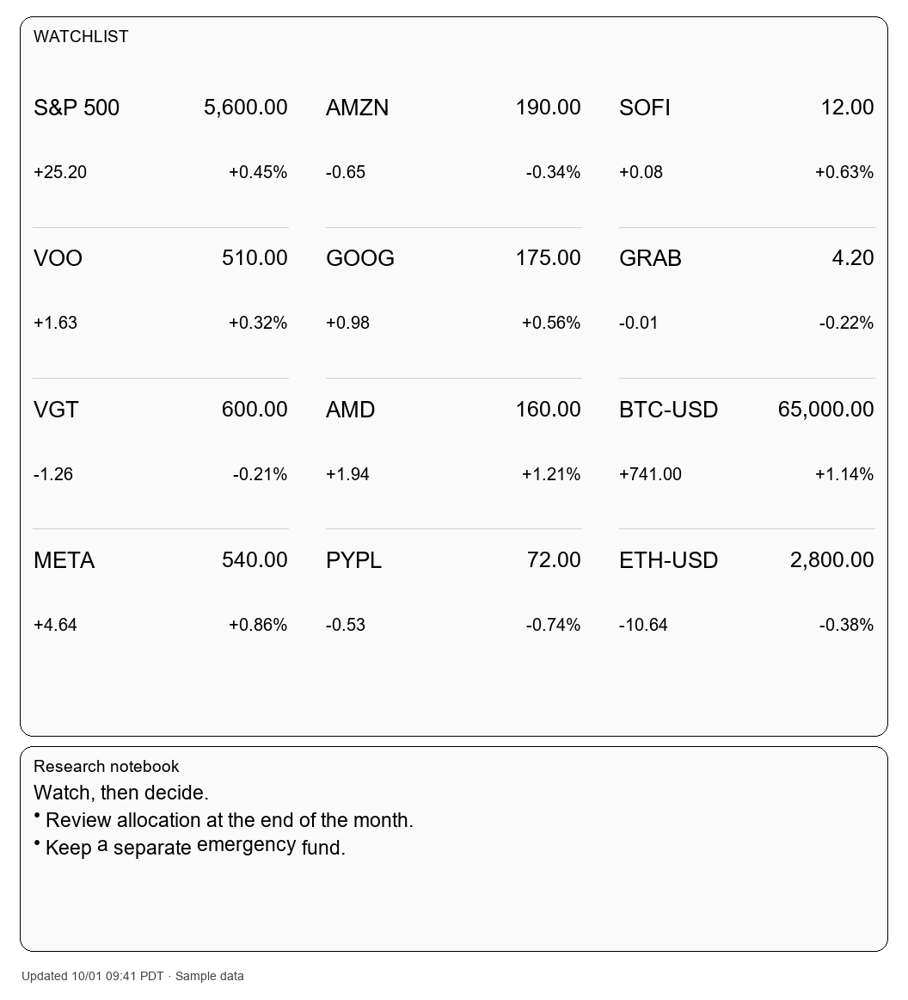](markets.png) |
| [Import this layout](overview.json) | [Import this layout](markets.json) |

| Weather and notes | Home server and backup |
| --- | --- |
| [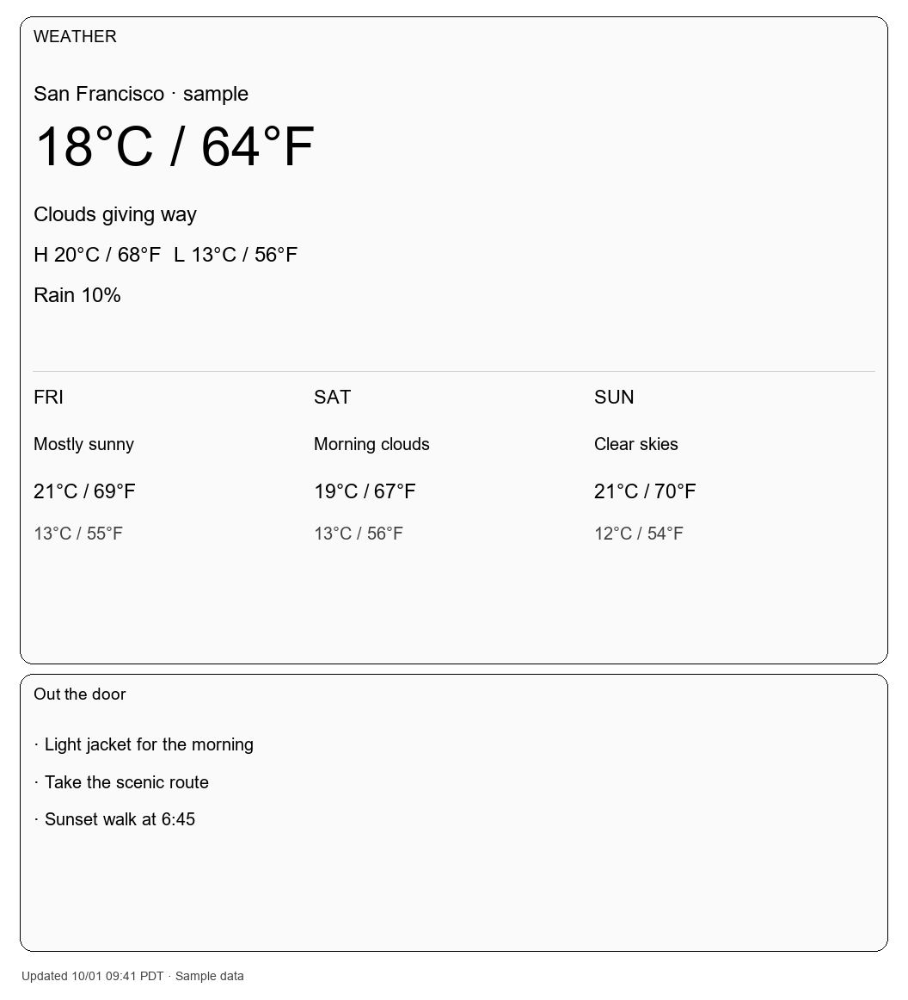](weather.png) | [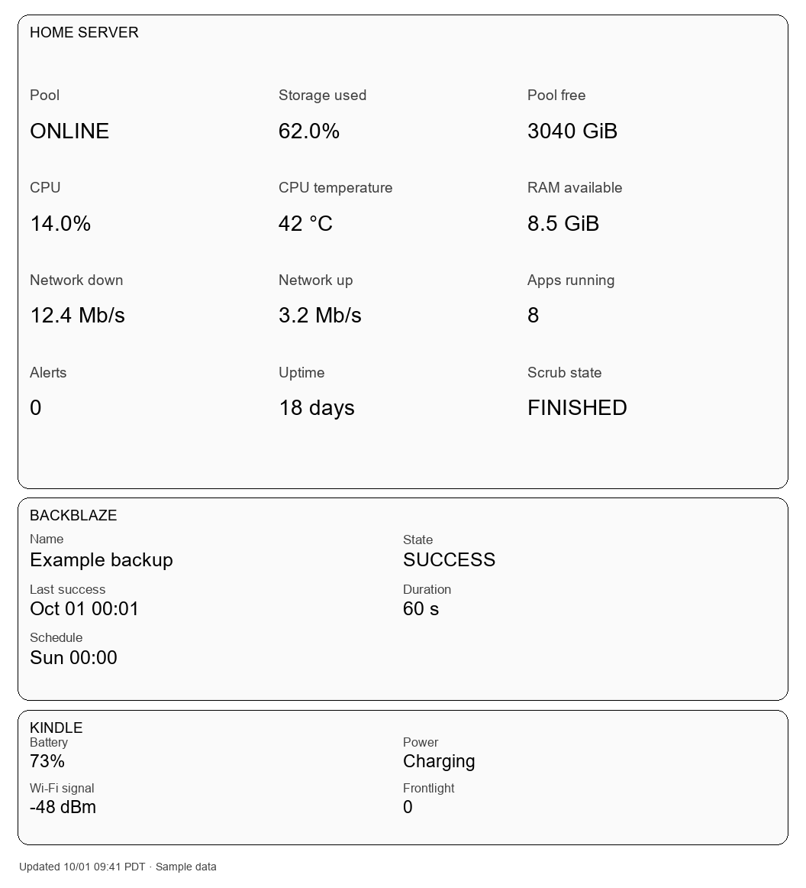](home-server.png) |
| [Import this layout](weather.json) | [Import this layout](home-server.json) |

| Markdown | Codex usage |
| --- | --- |
| [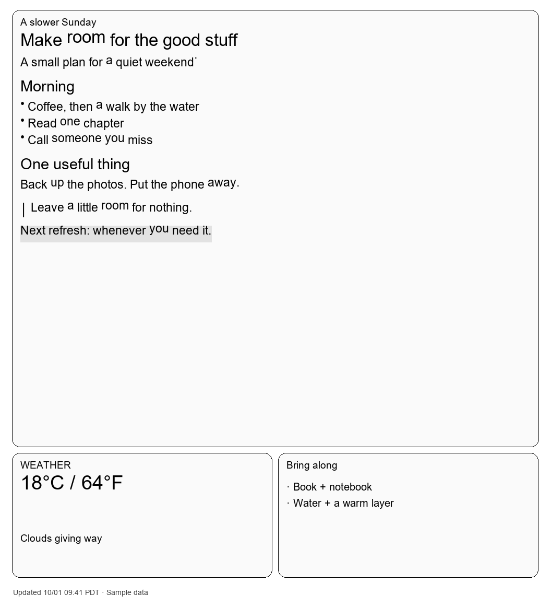](markdown.png) | [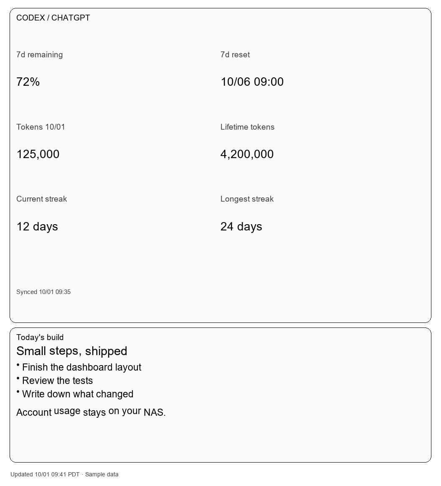](codex.png) |
| [Import this layout](markdown.json) | [Import this layout](codex.json) |

Download a JSON file, use **Layout files → Import JSON** in the editor, preview,
then save. These examples configure the Overview page; importing a layout replaces
the draft preferences, so export your current layout first if you want to keep it.

## The actual editor

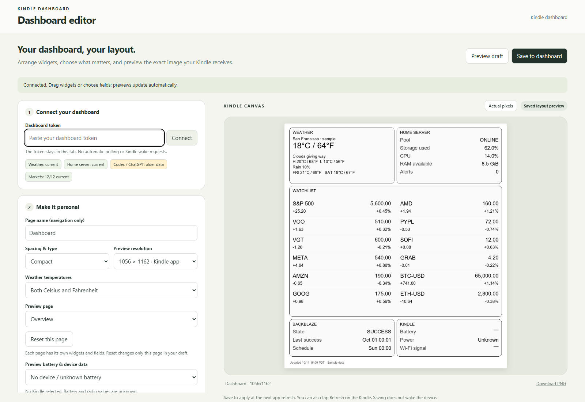

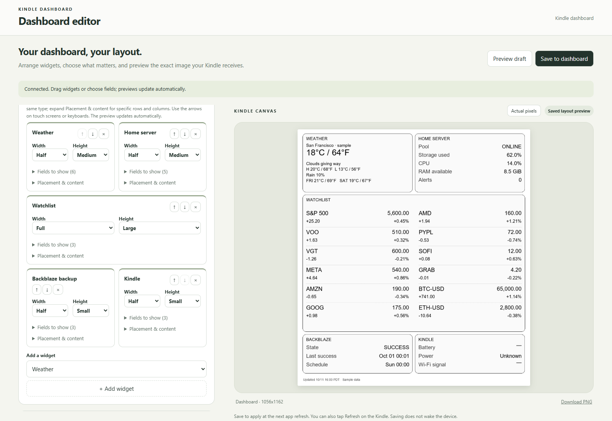

| Mobile editor | Kindle app interface |
| --- | --- |
| 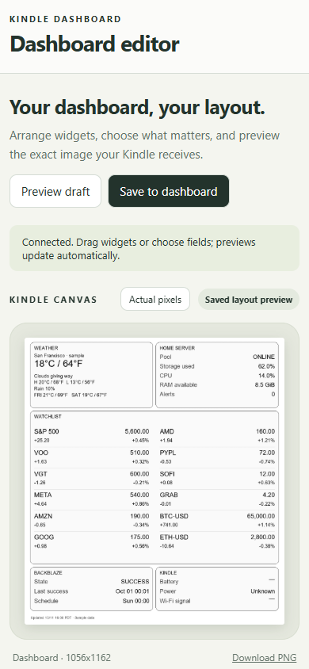 | 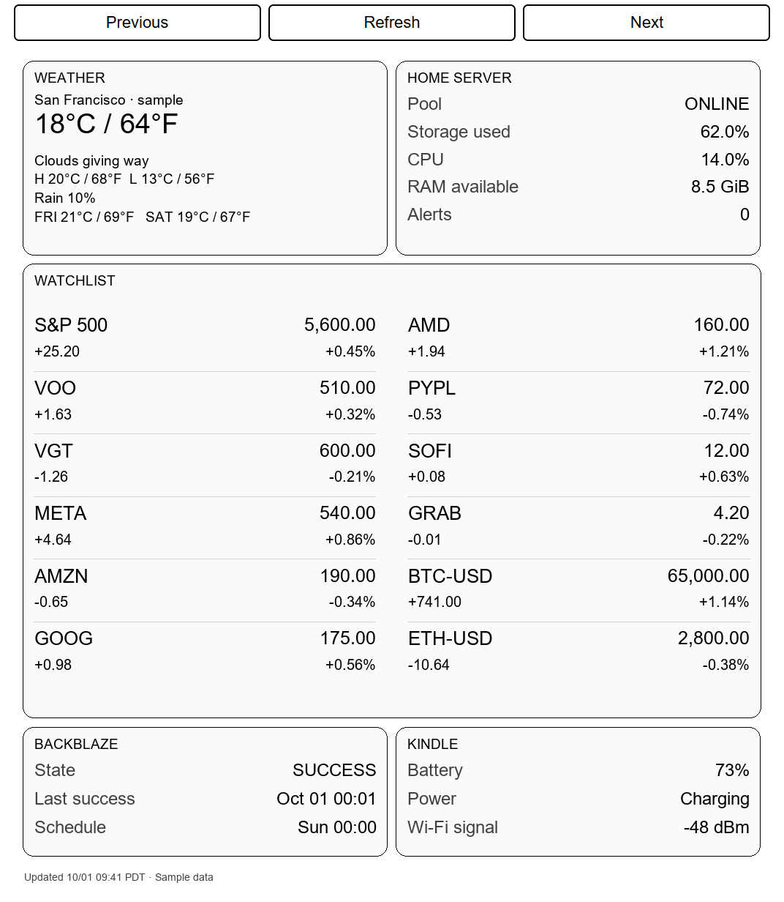 |

The app image is a browser capture of the actual client HTML and JavaScript with
a mock bridge. Hardware interaction is tested separately; this image is not proof
of compatibility with an untested device.

## When data gets old

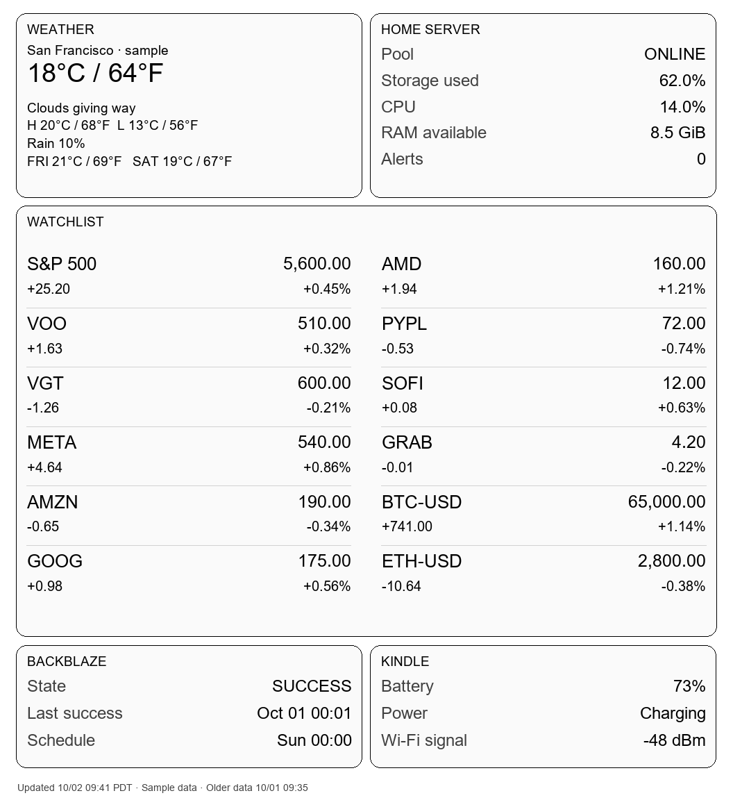

This render deliberately advances the clock while keeping the original source
timestamps. It demonstrates stale-source warnings. A completely offline Kindle
keeps the previously cached PNG unchanged, including its original generation time;
it cannot redraw a new server-generated warning while disconnected.

## Reproduce the gallery

```sh
pip install -r server/requirements-dev.txt
pip install playwright
playwright install chromium
python scripts/build-showcase.py
```

`DASHBOARD_TEST_BROWSER` optionally selects an installed Chromium/Edge executable.
`DASHBOARD_FONT_PATH` optionally selects a font. The NAS container uses DejaVu Sans;
Windows captures use Arial if available. Platform font rasterization can differ.

The generator starts an isolated loopback service with a disposable layout,
uses `scripts/demo_snapshot.py` plus fictional diagnostics and usage, and never
connects to a real NAS, Kindle, provider, or account. Static PNGs use a fixed time;
editor freshness uses the generation time. All fixture files are safe examples.
