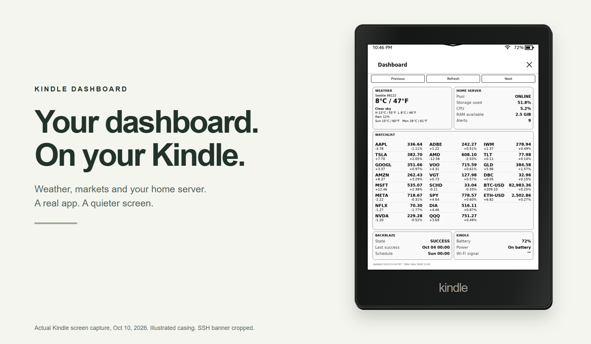
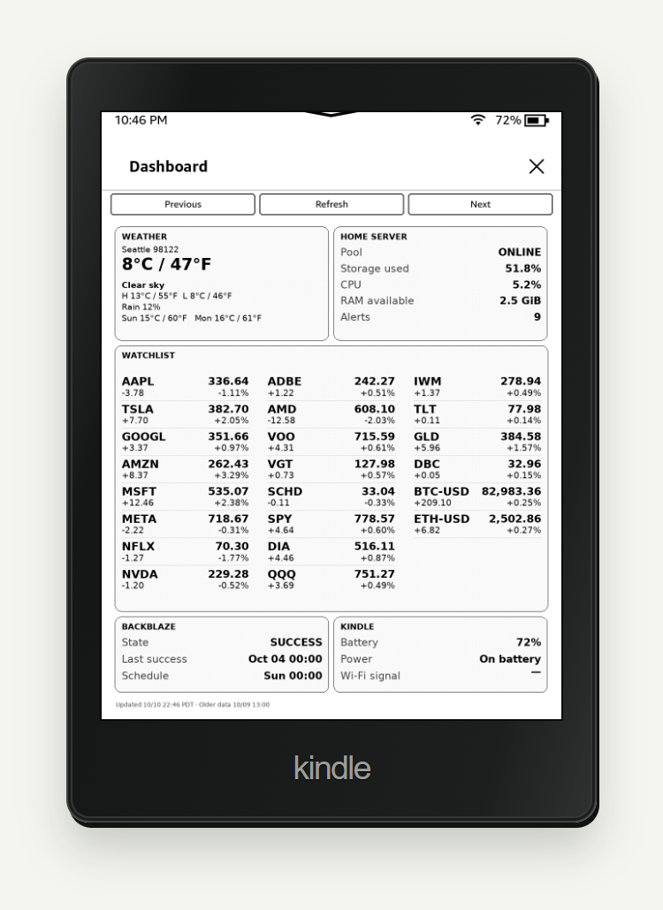
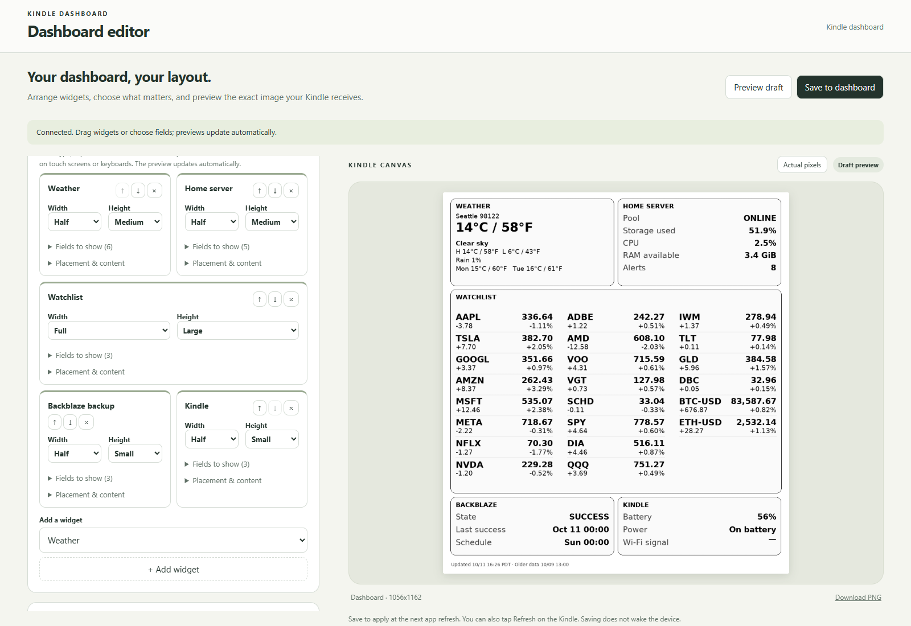
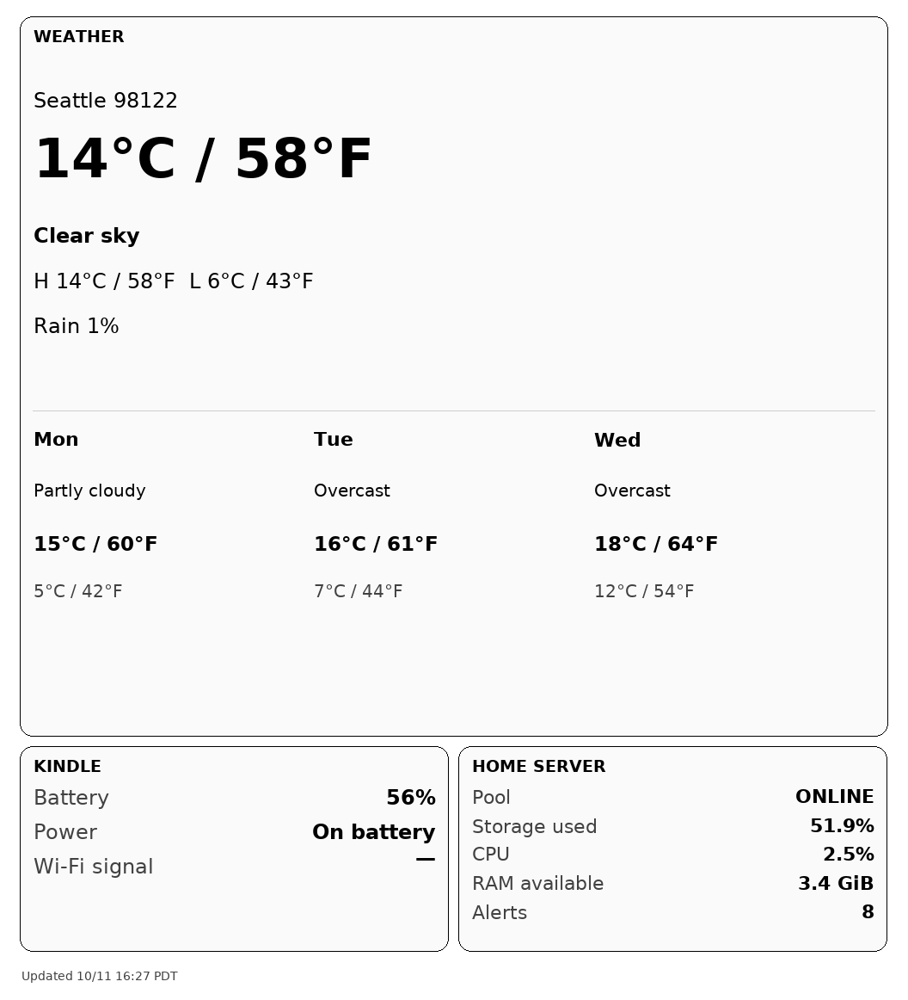
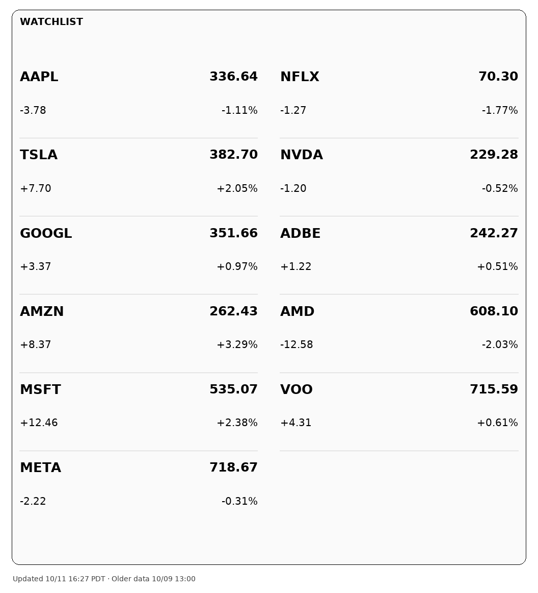
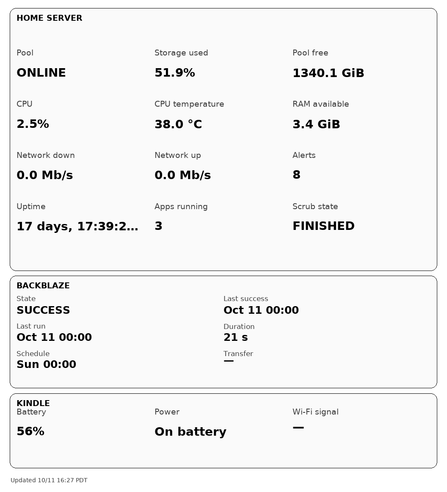

# Real device and NAS captures

These are captures of the running installation, rather than the synthetic gallery.
The physical casing is a code-drawn illustration. **This is not a photograph.**

| Capture | Provenance |
| --- | --- |
| [Kindle screen](kindle-overview.png) | Framebuffer captured on October 10, 2026, 22:46 Pacific, on the tested Paperwhite. The top 32 pixels containing the SSH address banner were cropped. All remaining screen pixels are retained, including native title bar, X, navigation, and stale-data timestamp. |
| [Desktop editor](editor-desktop.png), [widget editor](editor-widgets.png), [mobile editor](editor-mobile.png) | Browser screenshots from the running NAS service on October 11, 2026. Account-usage widget omitted in an unsaved preview draft; token field cleared. No saved configuration changed. |
| [Overview](nas-overview.png), [weather](weather.png), [markets](markets.png), [home server](home-server.png) | PNG downloads from the actual NAS editor on October 11, 2026. Real source snapshots and last-reported Kindle telemetry; retained dates may be older than capture time. These are server previews, not physical Kindle captures. |

| Live weather | Live markets | Live server |
| --- | --- | --- |
|  |  |  |

The [synthetic examples](../README.md) remain available for reproducible layouts,
including Markdown and Codex cards. Their data is explicitly labeled as sample.

To rebuild the illustrated frame and hero from these reviewed captures, run
`python scripts/build-real-showcase.py` with Playwright installed.
`DASHBOARD_TEST_BROWSER` can select an installed Chromium/Edge. This command does
not contact the NAS or Kindle. Do not replace these public files with unreviewed
screenshots containing credentials, network addresses or personal account details.
